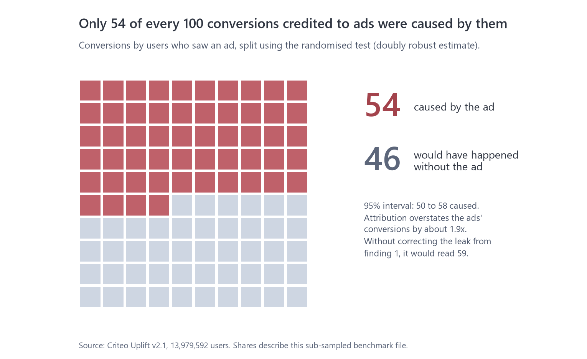
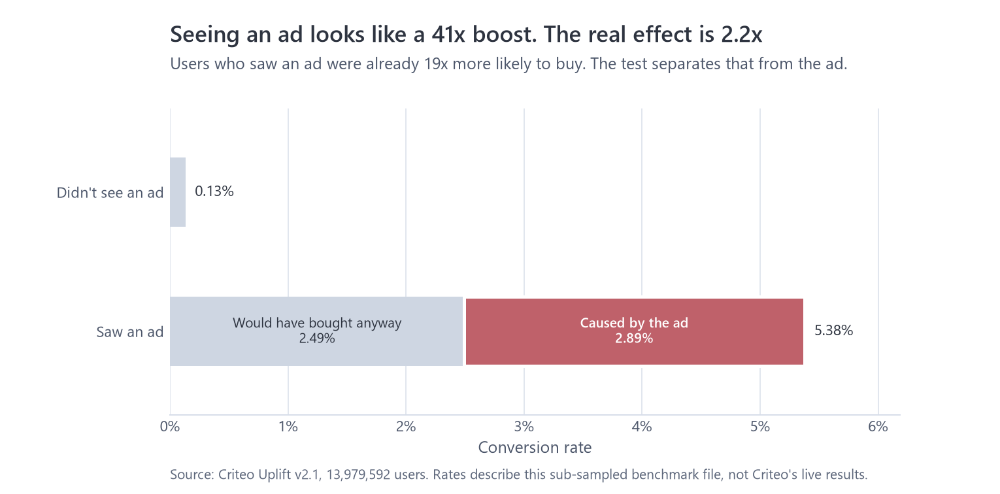

# Did the Ads Actually Work?

**How many sales do retargeting ads really cause, who is actually persuaded, is it worth the money, and how do you measure a campaign when you can't split users?** An incrementality study on a real randomised ad test of 13,979,592 users, plus 2,700 simulated geo tests on real Iowa sales.


[](LICENSE)

*Independent analysis of public data (Criteo Uplift v2.1, CC BY-NC-SA 4.0; Iowa Liquor Sales). Not affiliated with or endorsed by Criteo, Google or the State of Iowa.*

| 📄 [Report (PDF)](report/report.pdf) | 📊 [Dashboard](dashboard/) | 🖥️ [Slide deck (PDF)](presentation/deck.pdf) | 📓 [Notebooks](notebooks/) | 🧭 [Measurement plan](docs/recommendation.md) |
|---|---|---|---|---|

## The 30-second version

| | Finding | So what |
|---|---|---|
| **54 of every 100** | conversions credited to ads were caused by them (95% interval 50 to 58); the rest would have happened anyway | Attribution overstates retargeting's return by about 1.9x. Judge it on incremental, not attributed, results |
| **41x vs 2.2x** | Users who saw an ad look 41x likelier to buy; the real effect of seeing one is 2.2x | They were already 19x likelier to buy. Dashboards mistake keen shoppers for ad impact |
| **91%** | of the ads' effect sits in the top 20% of users; half the spend, aimed at likely buyers, keeps 84% of the conversions ads cause | Concentrate spend; a simple likely-buyer model finds these users as well as uplift models do |
| **+£1.40 vs +£0.29** | profit per £1 of ads: what the dashboard implies vs reality (illustrative ROAS 8, margin 30%); the weaker half of spend makes -£0.58 per £1 | At a 30% margin a campaign needs a dashboard ROAS above 6.2 to break even; its weaker half needs 19.2 |
| **9%** | is the smallest lift even a 20-county, 12-week geo test reliably detects on real Iowa sales; a CausalImpact-style model raised false alarms 10% to 18% of the time, not 5% | Use user-level holdouts where possible; size geo tests by simulation and placebo-test any model first |



**How it connects to [Project 1](https://github.com/sonny-888/ga4-marketing-analytics).** The Merch Store review showed that attribution models disagree and can't prove an ad caused a sale, and that its media mix model couldn't be calibrated without experiments. This project supplies the experiments.

## Business impact: the measurement plan

Every recommendation is backed by a finding and sized from the data. Full plan, decision guide and first-quarter calendar: [docs/recommendation.md](docs/recommendation.md).

| # | Action | Evidence | Success metric | Size |
|---|---|---|---|---|
| 1 | Report incremental ROAS (dashboard ROAS x caused share) next to attributed ROAS | Only 54 of 100 credited conversions were caused | Incremental ROAS above break-even | Break-even dashboard ROAS 6.2 at a 30% margin |
| 2 | Keep an always-on retargeting holdout | Caused share must be measured, not assumed | Conversion lift, with interval | 4.9 million users to see a +10% conversion lift with a 10% holdout (1.8 million with a 50/50 split); visits read with 0.9 million |
| 3 | Test cutting the weaker half of spend with its own holdout | Half the spend keeps 84% of the conversions ads cause | Caused conversions lost per £ saved | Predicted loss: 16% of caused conversions for half the spend |
| 4 | Target with a simple likely-buyer model | It matched uplift models on conversions | Effect captured per £ of spend | Revisit uplift models with more conversions |
| 5 | Geo tests only where holdouts are impossible; size by simulation first | Even 20 counties for 12 weeks only detect about 9% | Lift with a placebo-checked interval | Simulate on your own regional history |

## Checking the experiment before trusting it

The test looked clean: exactly 85.00% treated, as designed, and no feature differed between groups by more than 0.049 standard deviations. But at 14 million users even tiny gaps are real, so I went further:

| Check | Result | Meaning |
|---|---|---|
| Can a model tell treated from control users? | AUC 0.509 on 1 million users | Slightly, yes: a small leak |
| Is that a modelling artefact? | Placebo with shuffled labels: AUC 0.499 | No, the leak is real |
| Where does it come from? | Criteo merged several advertisers' tests with different treated shares; v2 tried to fix it | A small leftover link between features and treatment |
| Does it change the answer? | Visit lift +27% raw, +20% adjusted; conversion lift +59% raw, +52% adjusted | Yes. The features were logged before any ad, so adjusting is valid |

Two different adjustments (linear and doubly robust with cross-fitting) agree. Without them, the headline would read 59 caused conversions per 100 instead of 54. Details: [docs/experiment_health.md](docs/experiment_health.md), [docs/lift.md](docs/lift.md).



## How it was built

| Stage | What I did | Where |
|---|---|---|
| **Data** | Criteo test (14M users) downloaded and fingerprint-checked, converted to Parquet with DuckDB; Iowa county-week panel built with a BigQuery SQL query (CTEs, window functions) | `sql/`, `python/scripts/criteo_to_parquet.py`, `iowa_panel.py` |
| **Experiment health** | Sample ratio test, standardised mean differences, classifier two-sample test with placebo | `python/incrementality/experiment.py` |
| **Causal estimates** | Intent-to-treat lift with intervals; Lin regression adjustment; doubly robust AIPW with cross-fitting; instrumental variables (2SLS) for the effect of seeing an ad | `python/incrementality/lift.py` |
| **Who is persuaded** | T- and X-learner uplift models graded on 2.8M held-out users, by head count and by spend, with paired intervals and fair handling of tied scores | `python/incrementality/uplift.py` |
| **Money** | Incremental ROAS, profit per £, break-even and sensitivity tables, with test uncertainty carried through by simulation | `python/incrementality/money.py` |
| **Geo tests** | Difference-in-differences, synthetic control and a CausalImpact-style structural time series, graded on 2,700 simulated campaigns | `python/incrementality/geo.py` |
| **Planning** | Holdout sizing calculator, checked against the Criteo test's own precision | `python/incrementality/planning.py` |
| **Visualise** | One design system for every chart, the report, the deck and the Looker Studio dashboard | `design/`, `figures/`, `dashboard/` |
| **Communicate** | Report, slide deck and a measurement plan | `report/`, `presentation/`, `docs/` |

## Repository structure

```text
├── report/         report.pdf: the full report
├── presentation/   deck.pdf: the slide deck
├── dashboard/      Looker Studio link, screenshots and the data files behind it
├── notebooks/      01 data · 02 experiment checks · 03 lift · 04 uplift · 05 geo tests
├── sql/            the BigQuery query for the Iowa county-week panel
├── python/         incrementality/ (reusable code) · scripts/ (pipeline and charts) · tests/
├── docs/           one write-up per finding, plus the measurement plan
├── results/        small JSON files every chart, table and quoted number is read from
├── figures/        every chart in the report and README
└── design/         tokens.json: the colours and fonts every output uses
```

## Reproduce and verify

**Tested with** Python 3.14 on Windows 11.

```bash
python -m venv .venv
.venv\Scripts\activate
pip install -e ".[dev]"
```

1. **Criteo data:** download `criteo-research-uplift-v2.1.csv.gz` (311 MB) from [Criteo's Hugging Face page](https://huggingface.co/datasets/criteo/criteo-uplift) into `data/raw/`.
2. **Iowa data:** in the BigQuery console (free sandbox, your own Google account), run `sql/iowa_county_week.sql` and save the result as CSV into `data/raw/`. No credentials are stored anywhere in the project.
3. **Build everything:** `python python/scripts/run_all.py` (about 45 minutes; `--skip-slow` reuses the three slow steps' saved results and takes about 12). It runs the tests, every analysis, the charts and the notebooks, then checks the README against the results.

| Claim | Command | Expected |
|---|---|---|
| The analysis code is correct (lift, AIPW, 2SLS, uplift grading, geo methods, sizing) | `pytest -q` | 29 passed |
| Data arrived intact | `python python/scripts/criteo_to_parquet.py` | 13,979,592 rows, no missing values |
| Every number in the README, report and deck comes from the results | `python python/scripts/headline_facts.py` | matches; `pytest` fails if the README drifts |
| No secrets or personal details are published | `pytest python/tests/test_no_secrets.py` | passes |

## Limits

- **Benchmark data.** Criteo sub-sampled the file so its real incrementality can't be recovered; absolute numbers describe this file. The methods carry over; every business must measure its own caused share.
- **No prices or costs.** Money figures use a stated, illustrative ROAS and margin, with sensitivity tables and an assumption-free break-even rule.
- **Simulated campaigns.** The geo tests use real Iowa sales but invented campaigns, labelled as such on every chart.
- **Anonymised features.** Persuadable users can be described only by behaviour, not by who they are.

## Skills demonstrated

- **Causal inference:** randomised experiments, intent-to-treat, instrumental variables (2SLS), doubly robust estimation with cross-fitting, difference-in-differences, synthetic control, structural time series
- **Experiment design:** sample ratio and balance checks, classifier two-sample test with placebo, power and holdout sizing, false-alarm calibration by simulation
- **Machine learning:** T- and X-learner uplift models, gradient boosting, held-out grading with paired intervals
- **SQL and data engineering:** BigQuery query with CTEs and window functions, DuckDB, Parquet, a one-command pipeline
- **Business communication:** findings tied to evidence and money, uncertainty stated, recommendations written as sized tests
- **Engineering practice:** Git, unit tests that check methods against statsmodels and linearmodels, a leak scanner, one design system across outputs

## Data sources

- **Criteo Uplift Prediction Dataset v2.1**, Criteo AI Lab, [CC BY-NC-SA 4.0](https://creativecommons.org/licenses/by-nc-sa/4.0/). Diemert, Betlei, Renaudin and Amini, *A Large Scale Benchmark for Uplift Modeling*, AdKDD 2018; and Diemert et al., *A Large Scale Benchmark for Individual Treatment Effect Prediction and Uplift Modeling*, arXiv 2111.10106 (2021).
- **Iowa Liquor Sales**, Iowa Department of Revenue, via `bigquery-public-data.iowa_liquor_sales.sales`.

## Author

**Sharath Sista**
Data Analyst

[](https://github.com/sonny-888)
[](https://www.linkedin.com/in/sharath-chandra-2bb604377/)

## License

The code is licensed under the [MIT License](LICENSE). The data belongs to its publishers and keeps their terms; the Criteo data is for non-commercial use only.
