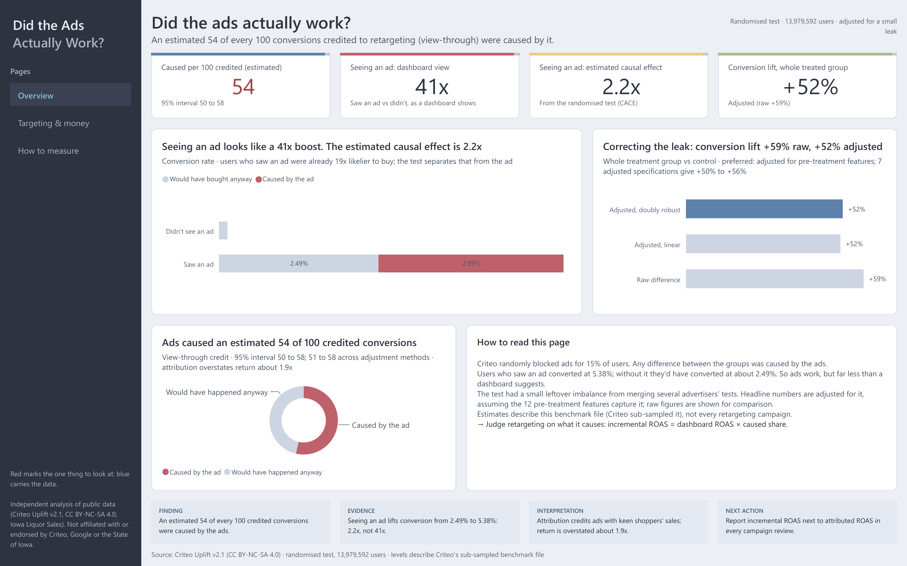

# Did the Ads Actually Work?

**How many sales do retargeting ads actually cause, and what should a marketer do about it?** An incrementality study on a public randomised ad test of 13,979,592 users, built around three decisions: should we trust attribution, should we move budget, and which experiment should we run next. A technical appendix benchmarks geo-test methods on real Iowa sales with 2,700 simulated campaigns.


[](LICENSE)

*Independent analysis of public data (Criteo Uplift v2.1, CC BY-NC-SA 4.0; Iowa Liquor Sales). Not affiliated with or endorsed by Criteo, Google or the State of Iowa.*

| 📄 [Report (PDF)](report/report.pdf) | 📊 [Dashboard (PDF)](dashboard/AdIncrementality.pdf) | ⬇️ [Power BI file](dashboard/AdIncrementality.pbix) | 🖥️ [Slide deck (PDF)](presentation/deck.pdf) | 📓 [Notebooks](notebooks/) | 🧭 [Measurement plan](docs/recommendation.md) |
|---|---|---|---|---|---|

## Three decisions, in 30 seconds

Every number describes this benchmark file (Criteo sub-sampled it, so levels are not Criteo's live results); the methods carry over.

| Decision | What the evidence says | Recommendation |
|---|---|---|
| **1. Should we trust attribution?** | An estimated **54 of every 100** conversions credited by view-through attribution were caused by the ads (95% interval 50 to 58). Users who saw an ad look **41x vs 2.2x**: 41x likelier to buy on a dashboard, 2.2x from the randomised test (CACE), because they were already 19x likelier to buy | Not on its own. Attribution overstates retargeting's return by about 1.9x; judge it on incremental ROAS (iROAS = attributed ROAS x caused share) |
| **2. Should we move budget?** | **91%** of the estimated effect sits in the top 20% of users; half the spend, aimed at likely buyers, keeps 84% of the conversions ads cause. In a scenario (dashboard ROAS 8, margin 30%), profit per £1 is **+£1.40 vs +£0.29**: what the dashboard implies vs incremental; the weaker half of spend makes -£0.58 per £1 | Probably, but test first. The split comes from a model, and moving budget can shift auction prices, frequency and audience mix. At a 30% margin a campaign needs a dashboard ROAS above 6.2 to break even; its weaker half needs 19.2 |
| **3. Which experiment next?** | A 50/50 holdout inside the weaker half (about 89% of users, half the ad views) predicts a +55% lift against a +131% break-even; about 0.4 million users settle it | Run that test, then keep an always-on holdout: 4.9 million users to see a +10% conversion lift with a 10% holdout (1.8 million with a 50/50 split); visits read with 0.9 million |


**How robust is the 54?** The raw comparison reads 59, because a small leak from merged advertiser tests inflates it (below). 7 adjusted specifications (linear, doubly robust, weighting only and outcome model only, with two model families) put conversion lift at +50% to +56% and the caused share at 51 to 58 per 100. The correction rests on one assumption we can't test: that the leak runs through the 12 features the file records.

**How it connects to [Project 1](https://github.com/sonny-888/ga4-marketing-analytics).** The Merch Store review showed that attribution models disagree and can't prove an ad caused a sale, and that its media mix model couldn't be calibrated without experiments. This project supplies the experiments: conversion lift from a randomised holdout, and a benchmark of geo experiments for channels that can't hold users out.

## Dashboard

Three-page Power BI dashboard, generated from code ([dashboard/](dashboard/)): **Overview** (below), [Targeting & money](dashboard/screenshots/2_targeting_money.png) and [How to measure](dashboard/screenshots/3_how_to_measure.png).



## The measurement plan

Every recommendation is backed by a finding and sized from the data. Full plan, decision guide and first-quarter calendar: [docs/recommendation.md](docs/recommendation.md).

| # | Action | Evidence | Success metric | Size |
|---|---|---|---|---|
| 1 | Report incremental ROAS (dashboard ROAS x caused share) next to attributed ROAS | An estimated 54 of 100 view-through-credited conversions were caused | Incremental ROAS above break-even | Break-even dashboard ROAS 6.2 at a 30% margin |
| 2 | Test cutting the weaker half of spend with a 50/50 holdout inside that segment | Half the spend keeps 84% of the conversions ads cause (model-based) | Relative conversion lift in the segment; guardrails on cost per ad view and frequency | About 0.4 million users; cut if the one-sided 95% upper bound is below the +131% break-even |
| 3 | Keep an always-on retargeting holdout | Caused share must be measured, not assumed | Conversion lift, with interval | 4.9 million users to see a +10% conversion lift with a 10% holdout (1.8 million with a 50/50 split); visits read with 0.9 million |
| 4 | Target with a simple likely-buyer model | It matched uplift models on conversions | Effect captured per £ of spend | Revisit uplift models with more conversions |
| 5 | Geo tests only where holdouts are impossible; size by simulation first | Methods benchmark: even 20 counties for 12 weeks only detect about 9% | Lift with a placebo-checked interval | Simulate on your own regional history |

## Checking the experiment before trusting it

The test looked clean: exactly 85.00% treated, as designed, and no feature differed between groups by more than 0.049 standard deviations. But at 14 million users even tiny gaps can matter, so I went further:

| Check | Result | Meaning |
|---|---|---|
| Can a model tell treated from control users? | AUC 0.509 on 1 million users | Slightly, yes: a small leak |
| Is that a modelling artefact? | Placebo with shuffled labels: AUC 0.499 | No, the leak is genuine |
| Where does it come from? | Criteo merged several advertisers' tests with different treated shares; v2 tried to fix it | A small leftover link between features and treatment |
| Does it change the answer? | Visit lift +27% raw, +20% adjusted; conversion lift +59% raw, +52% adjusted | Yes. The features were logged before any ad, so adjusting for them is safe; the adjusted figures are preferred |
| Does the correction depend on the method? | 7 adjusted specifications: conversion lift +50% to +56%, visits +19% to +20%; weighting shrinks the largest feature gap to 0.002 standard deviations | No. Every adjusted estimate sits below the raw one |

Without the adjustment, the headline would read 59 caused conversions per 100 instead of 54. Details: [docs/experiment_health.md](docs/experiment_health.md), [docs/lift.md](docs/lift.md).


## Technical appendix: geo tests as a methods benchmark

TV, outdoor and some ad platforms can't hold out individual users, so the fallback is a geo test. No real campaign is measured here: I added campaigns of known size to real weekly Iowa county sales (a uniform lift in randomly chosen counties, no spillover) and graded three methods on 2,700 simulated tests.

- **9%** is the minimum detectable effect (80% power) of even a 20-county, 12-week design. Typical ad effects of a few percent would usually be missed.
- Difference-in-differences and synthetic control kept false alarms near the promised 5%; a CausalImpact-style model raised them 10% to 18% of the time.
- So: use user-level holdouts where possible; size geo tests by simulation on your own regional history and placebo-test any model first. Details: [docs/geo.md](docs/geo.md).

## How it was built

| Stage | What I did | Where |
|---|---|---|
| **Data** | Criteo test (14M users) downloaded and fingerprint-checked, converted to Parquet with DuckDB; Iowa county-week panel built with a BigQuery SQL query (CTEs, window functions) | `sql/`, `python/scripts/criteo_to_parquet.py`, `iowa_panel.py` |
| **SQL cross-check** | The headline experiment numbers (split and sample-ratio test, naive multiple, intent-to-treat lift and interval, CACE, caused share) re-derived in plain SQL; a test proves SQL and Python agree | `sql/criteo_lift.sql`, `python/tests/test_sql_lift.py` |
| **Experiment health** | Sample ratio test, standardised mean differences, classifier two-sample test with placebo | `python/incrementality/experiment.py` |
| **Causal estimates** | Intent-to-treat lift with intervals; Lin regression adjustment; doubly robust AIPW with cross-fitting; instrumental variables (2SLS) for the effect of seeing an ad; sensitivity across 7 adjusted specifications and two model families | `python/incrementality/lift.py`, `sensitivity_analysis.py` |
| **Who is persuaded** | T- and X-learner uplift models graded on 2.8M held-out users, by head count and by spend, with paired intervals and fair handling of tied scores | `python/incrementality/uplift.py` |
| **Money (scenario)** | Incremental ROAS, profit per £, break-even and sensitivity tables, with test uncertainty carried through by simulation | `python/incrementality/money.py` |
| **Geo tests (appendix)** | Difference-in-differences, synthetic control and a CausalImpact-style structural time series, benchmarked on 2,700 simulated campaigns | `python/incrementality/geo.py` |
| **Planning** | Holdout sizing calculator, checked against the Criteo test's own precision; a sized budget-cut test with a decision rule | `python/incrementality/planning.py`, `budget_test_plan.py` |
| **Visualise** | Three-page Power BI dashboard generated from code (TMDL model, 33 DAX measures, PBIR report validated against Microsoft's schemas, text-fit checked); one design system for every chart, page and slide | `dashboard/`, `design/`, `figures/` |
| **Communicate** | Report and slide deck built from the results (every number checked by a test), and a measurement plan | `report/`, `presentation/`, `docs/` |

## Repository structure

```text
├── report/         report.pdf: the full report
├── presentation/   deck.pdf: the slide deck
├── dashboard/      Power BI dashboard (PDF and .pbix), its generator, all DAX, and the data files behind it
├── notebooks/      01 data · 02 experiment checks · 03 lift · 04 uplift · 05 geo tests
├── sql/            BigQuery query for the Iowa panel; the headline lift re-derived in plain SQL
├── python/         incrementality/ (reusable code) · scripts/ (pipeline and charts) · tests/
├── docs/           one write-up per finding, plus the measurement plan
├── results/        small JSON files every chart, table and quoted number is read from
├── figures/        every chart in the report and README
└── design/         tokens.json: the colours and fonts every output uses
```

## Reproduce and verify

**Tested with** Python 3.14 on Windows 11.

```bash
python -m venv .venv
.venv\Scripts\activate
pip install -e ".[dev]"
```

For the exact versions the results were produced with: `pip install -r requirements-lock.txt` then `pip install -e . --no-deps`.

1. **Criteo data:** download `criteo-research-uplift-v2.1.csv.gz` (311 MB) from [Criteo's Hugging Face page](https://huggingface.co/datasets/criteo/criteo-uplift) into `data/raw/`.
2. **Iowa data:** in the BigQuery console (free sandbox, your own Google account), run `sql/iowa_county_week.sql` and save the result as CSV into `data/raw/`. No credentials are stored anywhere in the project.
3. **Build everything:** `python python/scripts/run_all.py` (about 60 minutes; `--skip-slow` reuses the four slow steps' saved results and takes about 12). It runs the tests, every analysis, the charts and the notebooks, then checks the README against the results.

| Claim | Command | Expected |
|---|---|---|
| The analysis code is correct (lift, AIPW, 2SLS, uplift grading, geo methods, sizing) | `pytest -q` | 29 passed, 3 skipped (the 3 need the local data or the report and deck sources) |
| Data arrived intact | `python python/scripts/criteo_to_parquet.py` | 13,979,592 rows, no missing values |
| SQL and Python agree on every headline experiment number | `pytest python/tests/test_sql_lift.py` (after step 1) | passes |
| Every number in the README, report and deck comes from the results | `python python/scripts/headline_facts.py` | matches; `pytest` fails if the README drifts |
| No secrets or personal details are published | `pytest python/tests/test_no_secrets.py` | passes |

## Limits

- **Benchmark data.** Criteo sub-sampled the file so its real incrementality can't be recovered; absolute numbers describe this file. The methods carry over; every business must measure its own caused share.
- **One untestable assumption behind the correction.** Adjusting for the 12 features removes the leak only if it runs through them. Every adjusted method we tried agrees, but none can rule out a leak through something the file doesn't record.
- **No prices or costs.** Money figures are scenarios with a stated ROAS and margin, sensitivity tables and an assumption-free break-even rule.
- **The budget split is a hypothesis.** It comes from scoring users in a past test; in production, auction prices, ad frequency and audience mix respond to targeting changes. Hence the proposed test.
- **Geo is a methods benchmark.** Real Iowa sales, invented campaigns (uniform lift, random counties, no spillover), labelled as such on every chart.
- **Anonymised features.** Persuadable users can be described only by behaviour, not by who they are.

## Skills demonstrated

- **Marketing measurement:** conversion lift from a randomised holdout, view-through vs incremental conversions, incremental ROAS (iROAS), geo experiments, minimum detectable effect, MMM calibration
- **Causal inference:** randomised experiments, intent-to-treat, instrumental variables (2SLS, CACE), doubly robust estimation with cross-fitting, difference-in-differences, synthetic control, structural time series
- **Experiment design:** sample ratio and balance checks, classifier two-sample test with placebo, power and holdout sizing, false-alarm calibration by simulation
- **Machine learning:** T- and X-learner uplift models, gradient boosting, held-out grading with paired intervals
- **SQL and data engineering:** BigQuery query with CTEs and window functions; the headline experiment analysis re-derived in plain SQL and tested against Python; DuckDB, Parquet, a one-command pipeline
- **Business communication:** findings framed as decisions, uncertainty and assumptions stated, recommendations written as sized tests with decision rules
- **Power BI:** dashboard generated from code (TMDL semantic model, DAX measures, PBIR report), validated against Microsoft's schemas
- **Engineering practice:** Git, unit tests that check methods against statsmodels and linearmodels, a leak scanner, one design system across outputs

## Data sources

- **Criteo Uplift Prediction Dataset v2.1** (randomised incrementality tests of personalised display advertising, merged across several advertisers), Criteo AI Lab, [CC BY-NC-SA 4.0](https://creativecommons.org/licenses/by-nc-sa/4.0/). Diemert, Betlei, Renaudin and Amini, *A Large Scale Benchmark for Uplift Modeling*, AdKDD 2018; and Diemert et al., *A Large Scale Benchmark for Individual Treatment Effect Prediction and Uplift Modeling*, arXiv 2111.10106 (2021).
- **Iowa Liquor Sales**, Iowa Department of Revenue, via `bigquery-public-data.iowa_liquor_sales.sales`.

## Author

**Sharath Sista**
Data Analyst

[](https://github.com/sonny-888)
[](https://www.linkedin.com/in/sharath-chandra-2bb604377/)

## License

The code is licensed under the [MIT License](LICENSE). The data belongs to its publishers and keeps their terms. Results derived from the Criteo data (`results/`, `dashboard/data/`, the figures, report, deck and dashboard built from them) are shared under the same [CC BY-NC-SA 4.0](https://creativecommons.org/licenses/by-nc-sa/4.0/) licence: non-commercial use, with attribution to Criteo AI Lab. The raw data isn't redistributed here; download it from Criteo.
