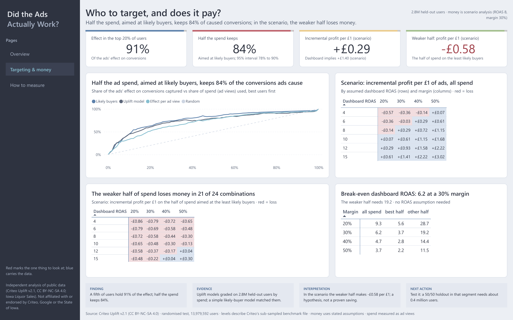
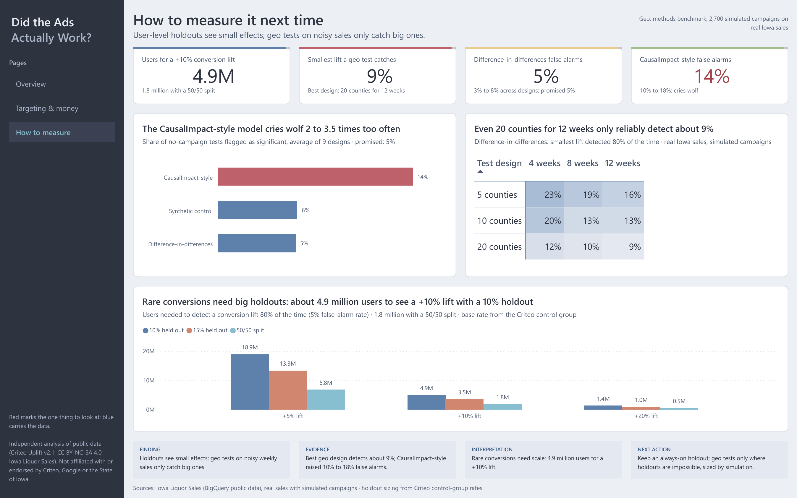

# Dashboard (Power BI)

Three pages in the Nordic style, generated entirely from code by [`build_pbip.py`](build_pbip.py): every table, DAX
measure, page and visual is defined there, validated against Microsoft's report schemas, and every number in a title
or note is read from `results/headline_facts.json`, so the dashboard can't drift from the README, report and deck. A
fit check estimates every title and text box against its size, so new wording can't overflow.

| 📊 [Dashboard (PDF)](AdIncrementality.pdf) | ⬇️ [Power BI file (.pbix)](AdIncrementality.pbix) | 🧮 [All DAX measures](measures.dax) |
|---|---|---|

## Pages

| Page | Question | What's on it |
|---|---|---|
| **Overview** | Did the ads actually work? | KPI cards (an estimated 54 caused per 100 credited, 41x vs 2.2x, adjusted lift); dashboard view vs estimated causal effect; raw vs adjusted lift, with the range across adjustment methods; credited vs caused |
| **Targeting & money** | Who to target, and does it pay? | Share of the effect captured by share of spend for three rankings; incremental profit per £1 by dashboard ROAS and margin (scenario), for all spend and the weaker half; break-even ROAS; the proposed budget-cut test |
| **How to measure** | How to measure it next time? | Geo methods benchmark: false alarms by method and smallest detectable lift by design; users a holdout needs to detect a +5%, +10% or +20% conversion lift |

Each page has the slate sidebar with page buttons, a one-line finding under the title, four KPI cards with a thin
colour bar, and a decision strip (finding, evidence, interpretation, next action). Red marks the one thing to look at;
blue carries the data. Money figures are labelled as a scenario; geo results are labelled a methods benchmark on
"real sales, simulated campaigns".

## Data

The model reads eight small CSVs in [`data/`](data/), written by `python/scripts/export_dashboard_data.py` from
`results/`. They hold aggregated results only; no user-level data.

| Table | Rows | Feeds |
|---|---|---|
| `kpis` | 15 | KPI cards (one measure per headline number) |
| `naive_vs_caused` | 3 | Dashboard view vs estimated causal effect |
| `lift_estimates` | 6 | Raw vs adjusted lift |
| `targeting_curves` | 1,414 | Effect captured by share of users or spend |
| `money_sensitivity` | 24 | Incremental profit per £1 by dashboard ROAS and margin (scenario) |
| `break_even` | 12 | Break-even dashboard ROAS |
| `geo_designs` | 27 | Geo methods: false alarms and smallest detectable lift |
| `holdout_users` | 18 | Users needed to detect a given lift, by share held out |

## Open or rebuild it

- **Just look:** open [`AdIncrementality.pdf`](AdIncrementality.pdf), or download [`AdIncrementality.pbix`](AdIncrementality.pbix)
  and open it in Power BI Desktop (the data is inside).
- **Rebuild from code:** `python dashboard/build_pbip.py --validate`, then open `dashboard/AdIncrementality.pbip` in
  Power BI Desktop and click **Home > Refresh**. If your copy of the project lives elsewhere, set the `DataFolder`
  parameter (**Transform data > Edit parameters**) to your `dashboard/data/` folder.
